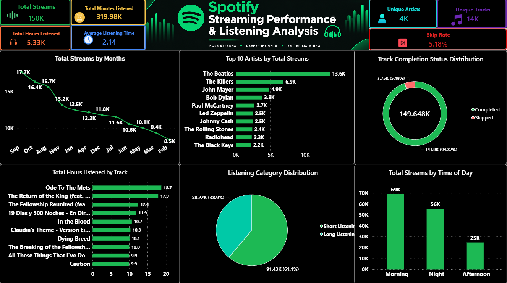
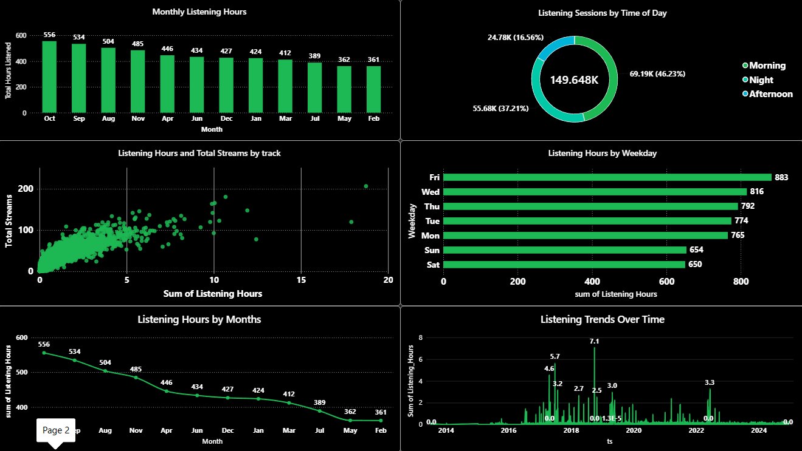
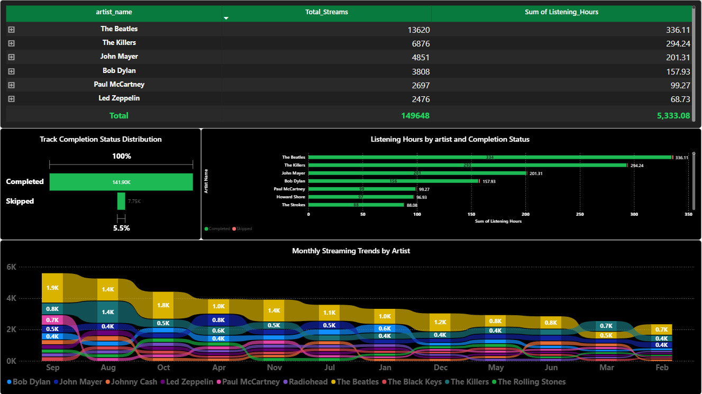

# 🎧 Spotify Streaming Performance & Listening Analysis

## 📌 Project Overview
This project focuses on analyzing Spotify listening history using **Microsoft Power BI** to understand streaming performance, listening behaviour, artist popularity, and track completion patterns.

An interactive three-page dashboard was developed to explore listening trends and gain insights from streaming data.

## 🛠️ Tools & Technologies
- Microsoft Power BI
- Power Query (Data Cleaning & Transformation)
- DAX (Calculated Measures & Columns)
- CSV Dataset

## 📊 Key Performance Indicators (KPIs)
- Total Streams
- Total Minutes Listened
- Total Hours Listened
- Average Listening Time
- Unique Artists
- Unique Tracks
- Skip Rate

## 📈 Dashboard Pages

**Page 1 – Streaming Overview**
- Monthly Total Streams
- Top 10 Artists by Streams
- Track Completion Status
- Top Tracks by Listening Hours
- Listening Category Distribution
- Streams by Time of Day

**Page 2 – Listening Behaviour**
- Monthly Listening Hours
- Listening Sessions by Time of Day
- Listening Hours vs Total Streams
- Listening Hours by Weekday
- Listening Trends Over Time

**Page 3 – Artist Analysis**
- Artist-wise Streaming Performance
- Listening Hours by Artist and Completion Status
- Monthly Streaming Trends by Artist
- Artist Performance Summary Table

## 📷 Dashboard Preview

### Page 1 – Overview

### Page 2 – Listening Behaviour

### Page 3 – Artist Analysis

## 📁 Project Files
- `spotify_history.csv` – Dataset used for analysis.
- `Screenshots/` – Dashboard screenshots.

## 🎯 Project Objective
To analyze personal Spotify streaming history, identify listening patterns, understand artist and track performance, and explore streaming behaviour through interactive visualizations.

---

**Project Type:** Data Analytics | **Tool:** Microsoft Power BI
